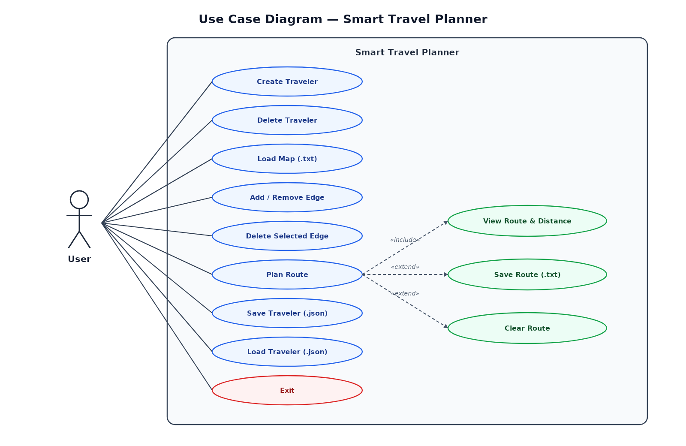
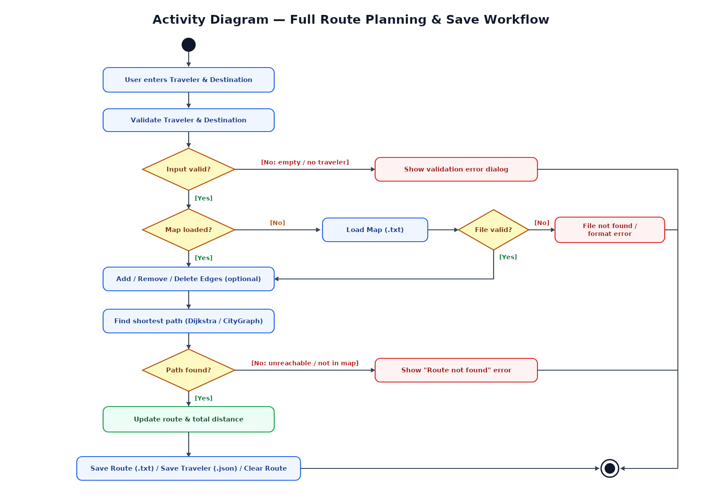
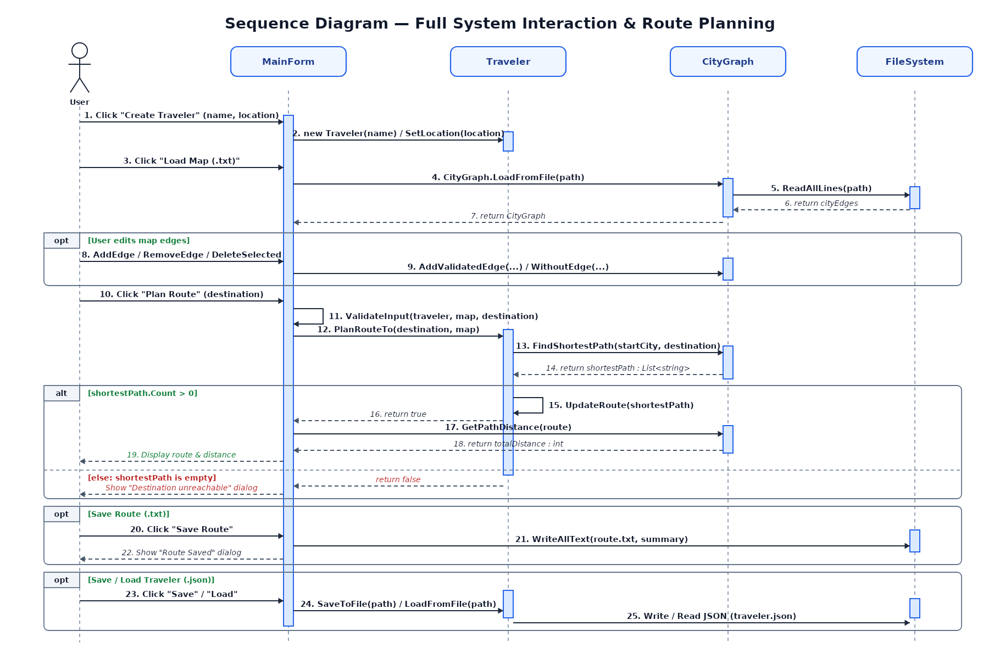

# Smart Travel Planner (Mission Control)

Desktop application built with C#, Avalonia UI (`FluentAvaloniaUI`), and MVVM for planning shortest travel routes between cities using `CityGraph` and `Traveler`.

## Use Case Diagram

## Activity Diagram

## Sequence Diagram

